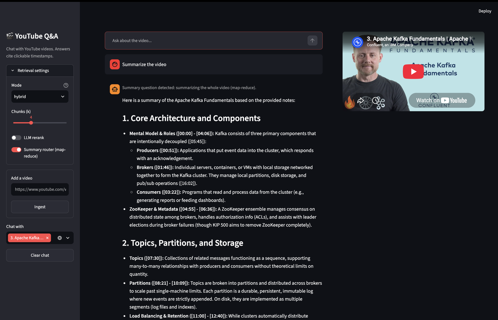
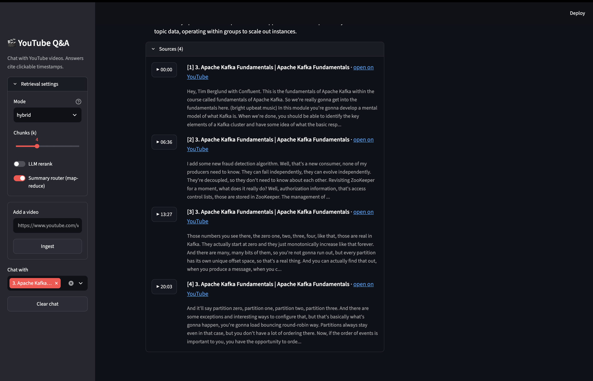

# RAG-Based YouTube Q&A System

Ask questions about any YouTube video and get answers grounded in its transcript, with
clickable timestamps that jump to the exact moment in the video.

Built with **LangChain**, **FAISS** and **Google Gemini**, with a **Streamlit** chat UI and a CLI.



Each answer lists its sources; click **▶** to jump the player to that moment:



## Features

- **Any video URL**, and chat with several videos at once
- **Timestamped sources**: every answer cites `[1] [2]` and links to `youtu.be/<id>?t=<seconds>`
- **Hybrid search**: BM25 keyword search + FAISS vector search, merged with reciprocal rank fusion
- **Follow-up questions**: chat history is used to rewrite "how does it work?" into a standalone question
- **Whole-video summaries**: "summarize the video" is routed to map-reduce over the full transcript
- **Embed once**: transcripts and FAISS indexes are cached on disk, so a video is never re-embedded
- **Grounded answers**: the model answers only from the retrieved excerpts, or says it doesn't know

## How it works

```
INGEST (once per video)
  YouTube URL
    → fetch transcript (youtube-transcript-api)   → cached in data/transcripts/
    → split into 60-second chunks, each keeps its start/end time
    → embed chunks with Gemini                    → FAISS index saved in data/indexes/

QUESTION (every time)
  question + chat history
    → rewrite follow-ups into a standalone question
    → router
        ├─ normal question: hybrid search (BM25 + FAISS) → top 4 chunks
        │                   → Gemini answers with [n] citations
        └─ summary question: summarize all chunks in batches (map) → combine (reduce)
    → answer streamed to the UI, with timestamp sources
```

## What it improves over a basic RAG

| Basic RAG | This project |
|---|---|
| One hardcoded video | Any video URL; several videos at once |
| Transcript joined into one string, timestamps lost | Every chunk keeps `start`/`end`; answers link to the moment in the video |
| Index rebuilt on every run | One FAISS index per video and chunking setup, saved to disk |
| Vector similarity only, k=2 | Similarity, MMR, or hybrid BM25 + FAISS, with optional LLM reranking |
| "Summarize the video" sees only 2 chunks | Summary questions use map-reduce over the whole transcript |
| No memory | Chat history; follow-ups are rewritten before searching |
| Generic errors | Clear messages for disabled captions, unavailable videos and IP blocks |

## Tech stack

| Part | Tool |
|---|---|
| Transcripts | `youtube-transcript-api` |
| Chunking | custom time-window chunker (character chunker as a baseline) |
| Embeddings | Gemini `gemini-embedding-001` |
| Vector store | FAISS (saved locally) |
| Keyword search | BM25 (`rank-bm25`) |
| LLM | Gemini `gemini-3.5-flash-lite` (free tier: 1,000 requests/day) |
| Orchestration | LangChain (LCEL chains) |
| UI | Streamlit, plus a CLI |
| Tests | pytest with fake LLM and embeddings (offline) |

## Project layout

```
ytrag/
  config.py        settings from .env and pipeline options (chunking, retrieval, k)
  youtube.py       video id parsing, transcript fetching and caching
  chunking.py      time-window chunker and character chunker
  index.py         build, save and load the FAISS index for a video
  retrieval.py     similarity, MMR and hybrid search, optional LLM rerank
  prompts.py       all prompts
  chains.py        question rewrite, router, answer chain, map-reduce helpers
  pipeline.py      RAGPipeline: ingest(), prepare(), ask(), used by the CLI and the UI
cli.py             command line: ingest, videos, ask, chat
streamlit_app.py   chat UI with sources and an embedded video player
tests/             offline tests (no API key needed)
eval/              RAGAS evaluation: datasets, experiment configs, results
```

## Setup

Requires Python 3.11+ and a free Gemini API key from [Google AI Studio](https://aistudio.google.com/apikey).

```bash
git clone https://github.com/nirvikarajendra/rag-youtube-qa-system.git
cd rag-youtube-qa-system
python3 -m venv .venv
source .venv/bin/activate
pip install -r requirements.txt
cp .env.example .env        # then open .env and set GOOGLE_API_KEY
```

## Usage

### Streamlit chat UI

```bash
streamlit run streamlit_app.py
```

Pick a video in the sidebar (two demo videos are already included in `data/`), or paste a YouTube
link and click **Ingest**. Then ask questions. Click a **▶ timestamp** under an answer to jump the
player to that moment.

### Command line

```bash
python cli.py ingest "https://www.youtube.com/watch?v=B5j3uNBH8X4"   # fetch, chunk, embed, save
python cli.py videos                                                 # list ingested videos
python cli.py ask B5j3uNBH8X4 "What is a producer?"                  # one question
python cli.py ask B5j3uNBH8X4 "Summarize the video"                  # map-reduce summary
python cli.py chat B5j3uNBH8X4                                       # multi-turn chat, streamed
```

Quote URLs that contain `?` (zsh treats it as a wildcard), or pass the bare video id.

Options: `--retrieval similarity|mmr|hybrid`, `-k <number of chunks>`, `--rerank`, and
`ingest --force` to rebuild an index.

### Tests

```bash
pytest
```

The tests use a fake LLM, fake embeddings and a synthetic transcript, so they run offline.

## Evaluation (RAGAS)

Evaluated with [RAGAS](https://docs.ragas.io) on **31 hand-written questions across two videos**,
each reference answer checked against the transcript. Question types: `fact`, `multi_chunk`,
`summary` and `unanswerable`. Generator and judge: `gemini-3.5-flash-lite`.

| Metric | What it checks | Kafka (24 min) | AI explainer (9 min) | Combined |
|---|---|---|---|---|
| Faithfulness | every claim is supported by the retrieved chunks | 1.000 | 0.949 | **0.984** |
| Answer relevancy | the answer addresses the question | 0.835 | 0.841 | **0.837** |
| Context precision* | useful chunks are ranked first | 0.912 | 0.792 | **0.874** |
| Context recall | retrieval found everything the reference needs | 0.877 | 1.000 | **0.917** |
| "I don't know" on unanswerable questions | | 2 / 2 | 1 / 1 | **3 / 3** |

\* On normal questions only; precision is not meaningful for map-reduce summaries.

**Against a basic RAG baseline** (500-char chunks, top-2 vector search; 17 Kafka questions, same judge):

| Metric | Baseline | This project |
|---|---|---|
| Context recall | 0.745 | **0.863** |
| Context precision | 0.765 | **0.912** |
| Faithfulness | 0.951 | **1.000** |
| Answer relevancy | 0.851 | 0.839 |
| Latency | 1.7 s | 1.8 s |

Full tables, per-question notes and caveats are in
[`eval/results/final_results.md`](eval/results/final_results.md); per-question scores are in
`eval/results/final_scores.csv`.

### Running the eval

```bash
python -m eval.run_eval --configs full --types fact multi_chunk      # Kafka questions
python -m eval.run_eval --configs baseline --types fact multi_chunk  # baseline comparison
python -m eval.run_eval --dataset eval/dataset_ai_video.jsonl --configs full
python -m eval.run_eval --score-only eval/results/runs/<file>.jsonl  # re-score saved answers
```

`eval/configs.yaml` also has step-by-step configs (`k4`, `time_chunks`, `hybrid`, `hybrid_rerank`)
that change one thing at a time. `python -m eval.generate_testset <url>` drafts more questions with
RAGAS; review every one before adding it to a dataset.

Notes:
- The free Gemini tier is rate limited (`gemini-3.5-flash-lite`: 15 requests/min). Run summary
  questions separately with `--types summary` and keep the default `--workers 2`.
- Gemini judges Gemini's answers, which can inflate scores; compare configs rather than reading
  the numbers as absolute quality.

## Configuration

All settings are optional except the API key. See `.env.example`:

| Variable | Default |
|---|---|
| `GOOGLE_API_KEY` | required |
| `YTRAG_CHAT_MODEL` | `gemini-3.5-flash-lite` |
| `YTRAG_JUDGE_MODEL` | `gemini-3.5-flash-lite` (RAGAS judge, eval only) |
| `YTRAG_EMBEDDING_MODEL` | `models/gemini-embedding-001` |
| `YTRAG_LANGUAGES` | `en,en-US,en-GB` |
| `YTRAG_MAX_VIDEO_MINUTES` | `180` |
| `YTRAG_HISTORY_TURNS` | `6` (chat messages used to rewrite follow-ups) |
| `YTRAG_DATA_DIR` | `./data` |

## Demo data

`data/` is committed so the app works right after cloning or deploying, without re-embedding:

| Video | Length |
|---|---|
| [Apache Kafka Fundamentals](https://www.youtube.com/watch?v=B5j3uNBH8X4) (`B5j3uNBH8X4`) | 24 min |
| [Why so many AI developers are freaked out about AI](https://www.youtube.com/watch?v=OnXVUXktKxQ) (`OnXVUXktKxQ`) | 9 min |

```
data/
  transcripts/<video_id>.json                                   cached transcript
  indexes/<embedding_model>/<video_id>/<chunking>/index.faiss   vectors
                                                  /index.pkl     chunk text and ids
                                                  /chunks.json   chunks for BM25 and summaries
```

## Deploy to Streamlit Community Cloud

YouTube blocks transcript requests from most cloud servers, so videos are ingested locally and
the resulting `data/` folder is deployed with the code.

1. Ingest videos on your machine: `python cli.py ingest "<url>"`
2. Commit and push the updated `data/` folder.
3. On [share.streamlit.io](https://share.streamlit.io), create an app from this repo with main file
   `streamlit_app.py` and Python 3.12.
4. Under **Advanced settings → Secrets**, add your key (never commit `.env`):
   ```toml
   GOOGLE_API_KEY = "your-key"
   ```

The deployed app can chat with every video in `data/`. To add a video, repeat steps 1–2; the app
redeploys automatically. Videos ingested from the cloud app itself are lost when it restarts.

## Known limitations

- YouTube often blocks transcript requests from cloud servers, so new videos must be ingested
  locally (see above). A rotating proxy would allow ingesting from the cloud.
- Videos without captions are not supported yet (a Whisper speech-to-text fallback is the natural next step).
- The FAISS index is stored as local files, which suits a single-user app. A multi-user deployment
  would use a managed vector database and persistent storage.
